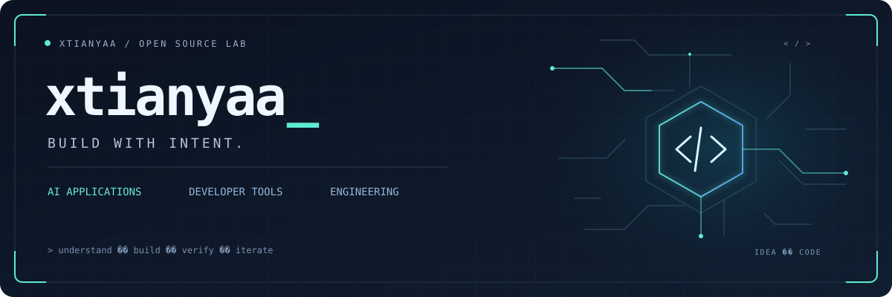

  

### 你好，我是 xtianyaa

把想法做成工具，把经验写成方法。

这里记录我的 **AI 应用、开发工具与工程实践**。关注需求如何说清、工具如何用顺，以及软件从想法到交付的整个过程。

[查看所有仓库 →](https://github.com/xtianyaa?tab=repositories)

 

## / 精选项目

<table>
  <tr>
    <td width="50%" valign="top">
      01 / AI · CONTENT
      <h3><a href="https://github.com/xtianyaa/ContentGen">ContentGen</a></h3>
      
一次选题，多平台成稿。

      
面向内容团队的 AI 创作工作台，串联选题、生成、审核、编辑与导出。

      
<code>Python</code> <code>FastAPI</code> <code>React</code>

    </td>
    <td width="50%" valign="top">
      02 / AI · PRODUCT
      <h3><a href="https://github.com/xtianyaa/requirements-to-prd">requirements-to-prd</a></h3>
      
让需求有来源，让设计可评审。

      
从招标文件、需求书与访谈出发，整理可追溯的 PRD、页面字段和待决问题。

      
<code>Agent Skills</code> <code>Markdown</code> <code>PRD</code>

    </td>
  </tr>
  <tr>
    <td width="50%" valign="top">
      03 / LOCAL · TOOLS
      <h3><a href="https://github.com/xtianyaa/Keynest">Keynest · 钥巢</a></h3>
      
密码与 API Key，收在本地。

      
本地优先的桌面密码与密钥管理工具，采用主密码与本地保险库模型，目前处于 MVP 阶段。

      
<code>Tauri</code> <code>React</code> <code>TypeScript</code>

    </td>
    <td width="50%" valign="top">
      04 / DEV · WORKFLOW
      <h3><a href="https://github.com/xtianyaa/flowforge">FlowForge</a></h3>
      
让 AI 协作有清楚的工程路径。

      
覆盖需求、架构、feature 执行与测试的协作模板，通过变更记录和门禁检查跟踪交付。

      
<code>AI Workflow</code> <code>Templates</code> <code>Quality Gates</code>

    </td>
  </tr>
</table>

**也在做：** [mall · 元选微信商城](https://github.com/xtianyaa/mall) — 小程序、管理后台与 Java 服务端的核心商城实践。

 

## / 技术与实践

| 方向 | 项目中使用的技术与方法 |
| :--- | :--- |
| AI 应用 | Agent Skills · 多平台内容生成 · 工作流与人工审核 |
| Web 开发 | TypeScript · React · Vue 3 · Python · FastAPI · Java · Spring Boot |
| 桌面与数据 | Tauri · PostgreSQL · Redis · 本地保险库 |
| 工程方法 | 需求追溯 · PRD · feature 交付 · 测试与验收 |

 

## / 我在意的事

- **先把问题说清。** 保留需求依据，把未知项留在明处。
- **让工具贴近使用。** 从真实任务出发，减少多余步骤。
- **让结果经得起验证。** 记录改动、检查结果，再继续迭代。

 

  

